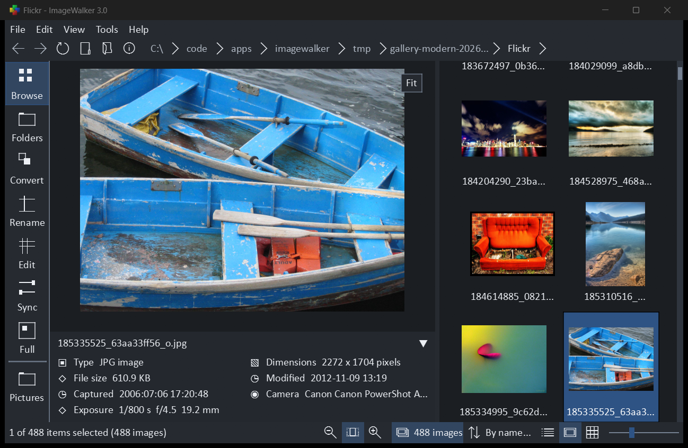
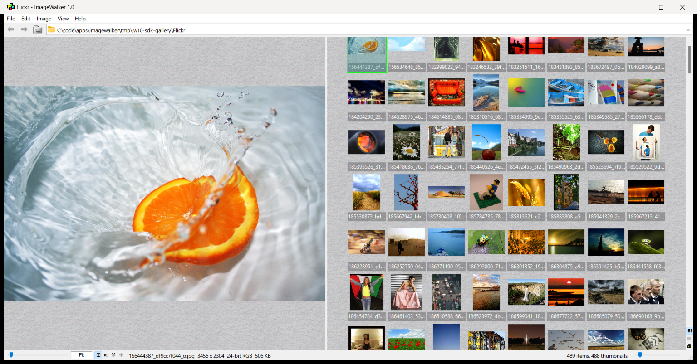
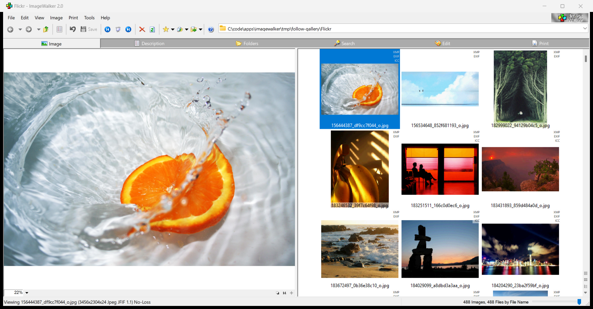
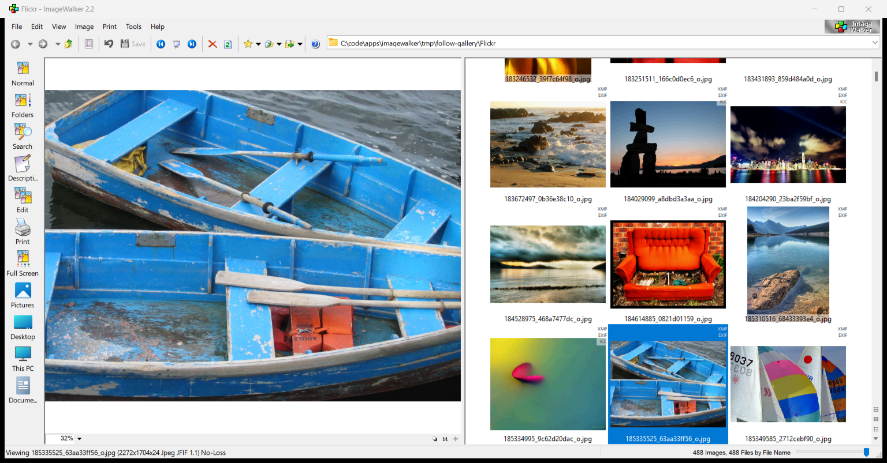
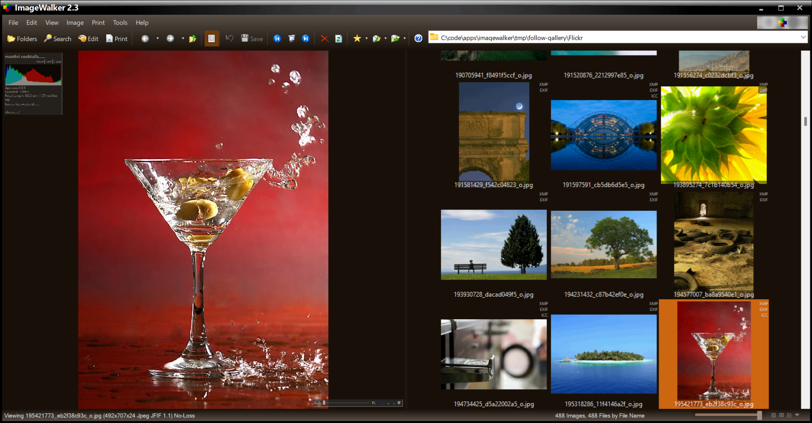

# ImageWalker

[](https://github.com/ZacWalk/imagewalker/actions/workflows/ci.yml)

ImageWalker is a Windows image browser and viewer by
[Zac Walker](https://rethinkify.com/). This repository builds five of its
releases as standalone 32-bit and 64-bit Windows applications: four preserved releases, first
published between 1998 and 2006, and ImageWalker 3.0.

| Directory | Application | Year | New in this release |
|---|---|---:|---|
| `src10` | [ImageWalker 1.0](docs/features.md#imagewalker-10) | 1998 | Read-only thumbnail browser and viewer |
| `src20` | [ImageWalker 2.0](docs/features.md#imagewalker-20) | 2001 | Descriptions, print preview and slide shows |
| `src22` | [ImageWalker 2.2](docs/features.md#imagewalker-22) | 2003 | Compare and Print modes, Filters and Actions views, six batch tools |
| `src23` | [ImageWalker 2.3](docs/features.md#imagewalker-23) | 2006 | Image tagging, EXIF auto-rotation and the Resize Images wizard |
| `src30` | [ImageWalker 3.0](docs/features.md#imagewalker-30) | 2026 | Video and audio playback, reviewed file workflows and folder synchronization |

The table describes each release as first published;
[known-issues.md](docs/known-issues.md) lists what the rebuilt editions lack.

Each release keeps its own interface, settings and workflows. All five share
header-only imaging code under `include/iw`. File readers, documents, metadata
and codecs come from [libfiles](https://github.com/ZacWalk/libfiles); platform
services and runtime-dispatched pixel operations come from
[libdesktop](https://github.com/ZacWalk/libdesktop).

Every application is portable and free: settings sit beside the executable,
each executable carries its own help, and there is no registration, reminder
screen or feature limit. The Collection setup installs the five editions
side by side and the portable ZIP carries both architectures. See
[build.md](docs/build.md#collection-release) for packaging and Windows requirements.
For help or to report a bug, use [GitHub Issues](https://github.com/ZacWalk/imagewalker/issues).

## Screenshots

The [ImageWalker website](https://imagewalker.com/#screenshots-heading) uses the
same Flickr gallery captures. Click an image to view it at full size.

### ImageWalker 3.0

[](docs/screenshots/imagewalker-3.0.png)

### Preserved releases

| ImageWalker 1.0 | ImageWalker 2.0 |
|---|---|
| [](docs/screenshots/imagewalker-1.0.png) | [](docs/screenshots/imagewalker-2.0.png) |

| ImageWalker 2.2 | ImageWalker 2.3 |
|---|---|
| [](docs/screenshots/imagewalker-2.2.png) | [](docs/screenshots/imagewalker-2.3.png) |

## Build

PowerShell 7.4+, Git, Visual Studio 2026 with C++ and ATL, CMake 3.28+, Ninja
and Python 3.9+. The vendored [dd](https://github.com/ZacWalk/dd) driver runs
CMake, and ImageWalker's CMake recipes fetch and build the libraries it links.

```powershell
.\dd.ps1 build [debug|release|both]
.\dd.ps1 launch iw30
.\dd.ps1 test
.\dd.ps1 test --label headless # all five releases and shared checks, no visible UI
```

The targets are `iw10`, `iw20`, `iw22`, `iw23` and `iw30`. Executables, and the
help file each of them embeds, are written to `exe\`.
[build.md](docs/build.md) covers toolchain setup, tests, help and dependencies.
You can [build 1.0 on its own](docs/build.md#sdk-only-imagewalker-10)
with the Windows SDK and libfiles, without ATL or WTL.
The headless gate prints each harness's actual case/check counts, including
successful runs; the unfiltered gate also opens the applications for smoke
checks.

## Documents

### Releases and usage

| Document | Subject |
|---|---|
| [versions.md](docs/versions.md) | About boxes, theme songs and shortcuts that tell the releases apart |
| [features.md](docs/features.md) | What each release offers |
| [workflows-3.0.md](docs/workflows-3.0.md) | ImageWalker 3.0 file workflows |
| [known-issues.md](docs/known-issues.md) | Limitations and workarounds |

### Development

| Document | Subject |
|---|---|
| [build.md](docs/build.md) | Toolchain, build, tests, help and dependencies |
| [layout.md](docs/layout.md) | Where things live and who owns them |
| [imaging.md](docs/imaging.md) | Shared imaging architecture, adapters and validation |
| [app-rules.md](docs/app-rules.md) | Rules for all five applications |
| [architecture-2x.md](docs/architecture-2x.md) | ImageWalker 2.x development guidelines |
| [porting.md](docs/porting.md) | Compiler, resource and Win32 constraints of the WTL releases, and code formatting |
| [reliability.md](docs/reliability.md) | File, image and threading safety requirements |
| [warnings.md](docs/warnings.md) | Compiler warning and clang-tidy policy |

## Licence

[MIT](LICENSE) licensed. All five executables include
[libdesktop](https://github.com/ZacWalk/libdesktop) and
[libfiles](https://github.com/ZacWalk/libfiles), which are licensed under the
Mozilla Public License 2.0: anyone distributing an executable must tell its
recipients where to get their source code, including any changes made to it.
`tools/iconlib.py` is vendored from libdesktop under the same licence.

libfiles' IPTC reader, in every executable, and its EXIF listing, in 2.0, 2.2
and 2.3, are ported from libiptcdata and libexif and keep their
LGPL-2.1-or-later; [libfiles' licence](https://github.com/ZacWalk/libfiles#licence)
lists the files. Anyone distributing an executable must also let its users
relink it with modified versions of those files (LGPL-2.1 section 6): include
the LGPL text, the files' corresponding source, and the application source and
build instructions or relinkable object files, and permit modification for the
recipient's own use and reverse engineering to debug those modifications.

Code others wrote keeps the terms stated in its files: the WTL headers in
`include/wtl`, under the Microsoft Public License
([MS-PL.txt](include/wtl/MS-PL.txt)); the RSA Data Security, Inc. MD5
Message-Digest Algorithm in the `UtilMd5` files of `src20`, `src22` and `src23`;
the Independent JPEG Group's lossless transforms in
`include/iw/legacy/FileJpegTran.h`; and the colour button in
`include/iw/ColorButton.h`.

ImageWalker's successor is [Diffractor](https://diffractor.com/).
