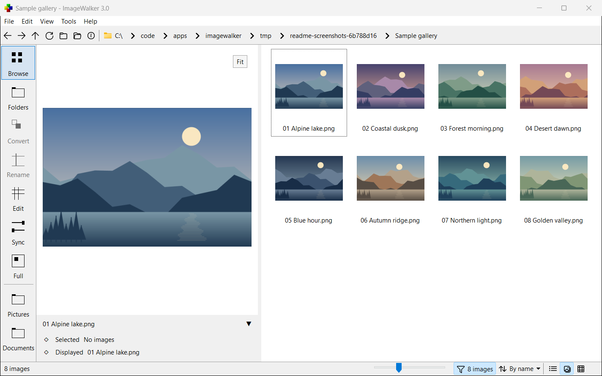
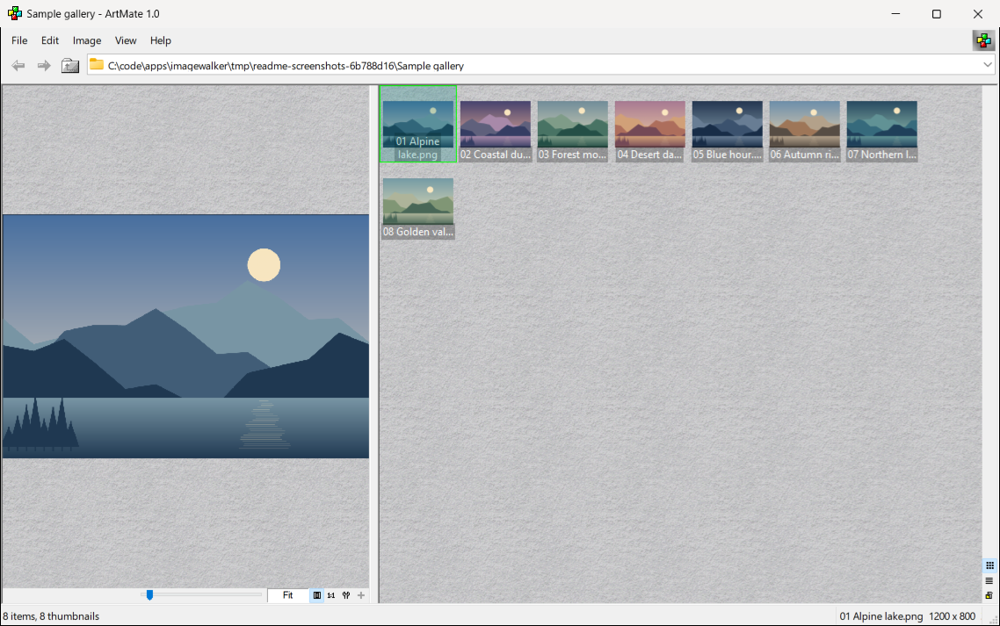
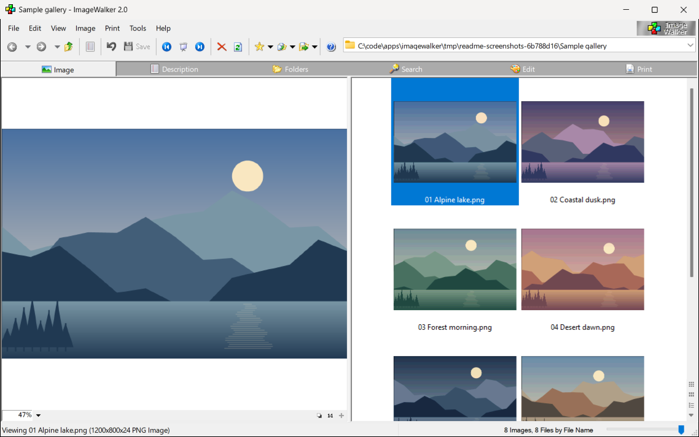
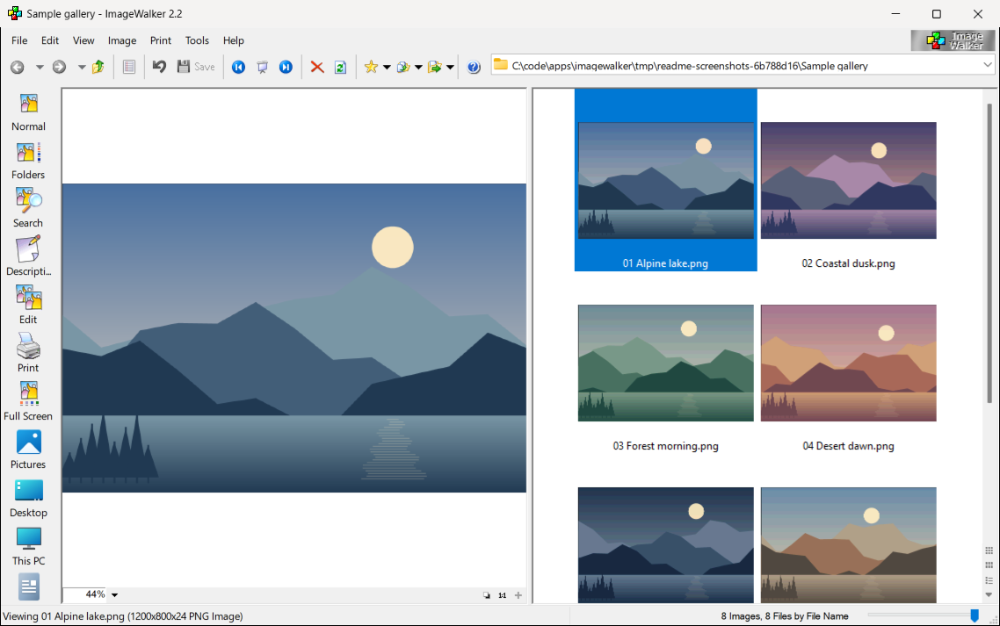
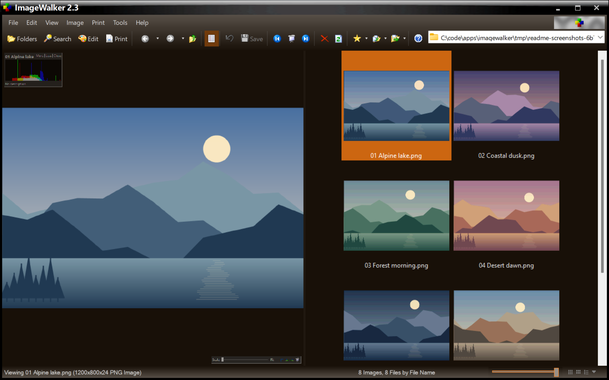

# ImageWalker

[](https://github.com/ZacWalk/imagewalker/actions/workflows/ci.yml)

ImageWalker is a Windows image browser and viewer by
[Zac Walker](https://rethinkify.com/). The historical versions, released between
1998 and 2006, are updated to build and run on modern 64-bit Windows.
ImageWalker 3.0 continues the series.

| Directory | Application | Year | New in this release |
|---|---|---:|---|
| `src10` | ArtMate 1.0 | 1998 | Read-only thumbnail browser and viewer |
| `src20` | ImageWalker 2.0 | 2001 | Descriptions, print preview and slide shows |
| `src22` | ImageWalker 2.2 | 2003 | Compare and Print modes, Filters and Actions views, six batch tools |
| `src23` | ImageWalker 2.3 | 2006 | Image tagging, EXIF auto-rotation and the Resize Images wizard |
| `src30` | ImageWalker 3.0 | 2026 | Video and audio playback, reviewed file workflows and folder synchronization |

See [features.md](docs/features.md) for release-by-release highlights and
[known-issues.md](docs/known-issues.md) for limitations.

Every application is portable and free. Settings sit beside the executable,
each executable carries its own help, and there is no registration, reminder
screen or feature limit.

## Screenshots

All five applications are shown browsing the same original sample illustrations.
Click an image to view it at full size.

### ImageWalker 3.0

[](docs/screenshots/imagewalker-3.0.png)

### Historical versions

| ArtMate 1.0 | ImageWalker 2.0 |
|---|---|
| [](docs/screenshots/artmate-1.0.png) | [](docs/screenshots/imagewalker-2.0.png) |

| ImageWalker 2.2 | ImageWalker 2.3 |
|---|---|
| [](docs/screenshots/imagewalker-2.2.png) | [](docs/screenshots/imagewalker-2.3.png) |

## Build

PowerShell 7.4+, Git, Visual Studio 2026 with C++ and ATL, CMake 3.28+, Ninja
and Python 3.9+. The pinned shared [dd driver](https://github.com/ZacWalk/dd)
drives CMake; ImageWalker's own CMake recipes fetch and build the third-party
dependencies.

```powershell
.\dd.ps1 build [debug|release|both]
.\dd.ps1 launch iw30
.\dd.ps1 test
```

Application IDs are `iw10`, `iw20`, `iw22`, `iw23` and `iw30`. `launch` opens a
persistent session; shared `run` is bounded to 120 seconds. Executables and the
shared help file (with separate 3.0 topics) are written to `exe\`, and every
executable embeds that help file.

## Documents

### Releases and usage

| Document | Subject |
|---|---|
| [history.md](docs/history.md) | The story of ImageWalker |
| [versions.md](docs/versions.md) | Release names, dates and theme songs |
| [features.md](docs/features.md) | Features introduced in each version |
| [workflows-3.0.md](docs/workflows-3.0.md) | ImageWalker 3.0 file workflows |
| [known-issues.md](docs/known-issues.md) | Limitations and workarounds |

### Development

| Document | Subject |
|---|---|
| [build.md](docs/build.md) | Toolchain, build, tests, help and dependencies |
| [layout.md](docs/layout.md) | Repository ownership and file locations |
| [architecture-2x.md](docs/architecture-2x.md) | ImageWalker 2.x development guidelines |
| [porting.md](docs/porting.md) | Compiler, resource and Win32 constraints |
| [app-rules.md](docs/app-rules.md) | Application development rules |
| [reliability.md](docs/reliability.md) | File, image and threading safety requirements |
| [warnings.md](docs/warnings.md) | Warning policy and triage |
| [todo.md](docs/todo.md) | Outstanding development |

MIT licensed. ImageWalker's successor is [Diffractor](https://diffractor.com/).
